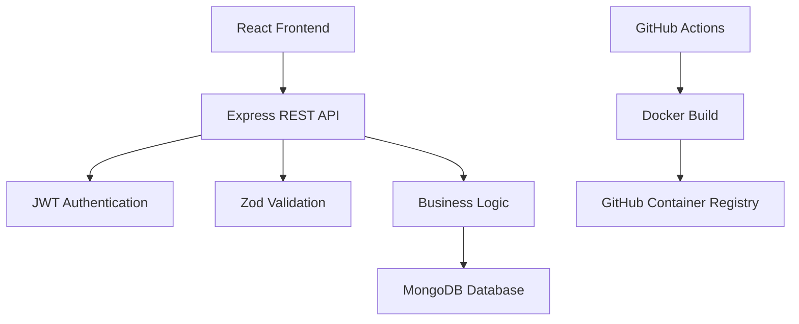
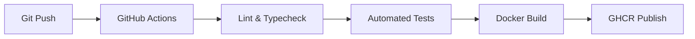

# 🚀 IROP — IT Resource & Operations Platform

<div align="center">


A centralized platform for managing people, assets, and workplace resources.

<p align="center">
  <a href="https://github.com/YOUR_USERNAME/YOUR_REPO/actions"></a>
  <a href="https://github.com/features/packages"></a>
  
  
</p>

</div>

---

## 📌 Overview

**IROP (IT Resource & Operations Platform)** is a production-grade internal operations platform designed for modern technology organizations.

It brings essential workplace operations into one centralized portal, enabling organizations to efficiently manage:

- 👥 HR Leave Management
- 💻 Hardware & Software Asset Management
- 📦 Office Inventory Management

Built with a modern full-stack architecture, IROP focuses on security, scalability, automation, and maintainability.

---

## ✨ Core Modules

<table>
<tr>
<td width="33%" valign="top">

### 👥 Leave Management

Automate employee leave workflows.

- Role-based approvals
- Weekday calculations
- Leave quota tracking
- Overlap prevention
- Atomic quota deductions

</td>
<td width="33%" valign="top">

### 💻 Asset Management

Manage organizational IT assets.

- Hardware tracking
- Software licenses
- Assignment lifecycle
- Asset availability
- Search and filtering

</td>
<td width="33%" valign="top">

### 📦 Inventory Management

Monitor office supplies and stock.

- Inventory tracking
- Low-stock alerts
- Quantity controls
- Role-based permissions
- Stock threshold monitoring

</td>
</tr>
</table>

---

## 🏗️ System Architecture

IROP follows a modular client-server architecture.



---

## 🛠️ Technology Stack

| Layer | Technology |
|---|---|
| Language | TypeScript (Strict) |
| Backend | Node.js & Express 5 |
| Database | MongoDB & Mongoose |
| Validation | Zod |
| Authentication | JWT & bcrypt |
| Frontend | React 18 & Vite |
| Styling | Tailwind CSS |
| Data Fetching | TanStack Query |
| Containerization | Docker & Compose |
| CI/CD | GitHub Actions |
| Container Registry | GHCR |

### Why These Technologies?

- **TypeScript:** Strict type safety across the application.
- **Express:** Lightweight and scalable REST API development.
- **MongoDB:** Flexible document-based data management.
- **Zod:** Runtime validation for requests and environment variables.
- **JWT & bcrypt:** Secure authentication and password hashing.
- **TanStack Query:** Caching, background refetching, and mutation management.
- **Docker:** Reproducible containerized deployments.
- **GitHub Actions:** Automated quality checks and container publishing.

---

## 📚 Project Documentation

All technical documentation is organized inside the `documents/` directory.

| Document | Description |
|---|---|
| Systems R&D Report | Research and technology analysis |
| Docker & CI/CD R&D | Containerization and deployment strategies |
| PRD | Product requirements and user stories |
| SRS | Functional and non-functional requirements |
| API Specification | REST API contracts and schemas |
| Architecture Decisions | Technical decisions and trade-offs |
| Test Report | Testing scenarios and verification |

PDF exports are available in `documents/pdf/`.

---

## 🔐 Demo Accounts

The database can be populated using:

```bash
npm run seed
```

This creates:

- 8 sample users
- 7 leave requests
- 10 assets
- 8 inventory items

Demo password for all accounts: `Demo@1234`

<details>
<summary><b>👥 View Demo Users & Roles</b></summary>

<br>

| Role | Name | Email | Department |
|---|---|---|---|
| Admin | Ayesha Khan | admin@irop.demo | Operations |
| Manager | Bilal Ahmed | bilal@irop.demo | Engineering |
| Manager | Sara Malik | sara@irop.demo | QA & Support |
| Employee | Usman Ali | usman@irop.demo | Engineering |
| Employee | Hina Raza | hina@irop.demo | Engineering |
| Employee | Zain Abbas | zain@irop.demo | Engineering |
| Employee | Maryam Noor | maryam@irop.demo | QA & Support |
| Employee | Daniyal Shah | daniyal@irop.demo | QA & Support |

</details>

---

## 💻 Getting Started

### Prerequisites

- Node.js 20+
- npm 10+
- MongoDB instance or MongoDB Atlas

### 1. Clone the Repository

```bash
git clone <repository-url>
cd <project-directory>
```

### 2. Configure Environment Variables

```bash
cd server
cp .env.example .env
```

Configure `server/.env`:

```env
PORT=5000
NODE_ENV=development
MONGODB_URI=mongodb+srv://<username>:<password>@<cluster>.mongodb.net/irop_dev?retryWrites=true&w=majority
MONGODB_URI_TEST=mongodb+srv://<username>:<password>@<cluster>.mongodb.net/irop_test?retryWrites=true&w=majority
JWT_SECRET=your-secure-random-secret-key-32-chars
JWT_EXPIRES_IN=1d
CLIENT_ORIGIN=http://localhost:5173
```

### 3. Seed the Database

```bash
cd server
npm run seed
```

### 4. Start the Backend

```bash
cd server
npm run dev
```

- Backend: `http://localhost:5000`
- Health Check: `http://localhost:5000/health`

### 5. Start the Frontend

Open another terminal:

```bash
cd client
npm run dev
```

- Frontend: `http://localhost:5173`

---

## 🐳 Docker Deployment

Run the complete application stack using Docker Compose:

```bash
docker compose up --build
```

| Service | Address |
|---|---|
| Frontend | http://localhost:8080 |
| Backend API | http://localhost:5000 |
| Health Check | http://localhost:5000/health |
| MongoDB | localhost:27017 |

> **Note:** Docker Compose uses a local MongoDB container by default. You can configure it to use MongoDB Atlas by updating the environment configuration.

---

## 🧪 Testing & Code Quality

<details>
<summary><b>Backend Quality Checks</b></summary>

```bash
cd server

npm run lint
npm run typecheck
npm run build
npm test
```

</details>

<details>
<summary><b>Frontend Quality Checks</b></summary>

```bash
cd client

npm run lint
npm run typecheck
npm test
npm run build
```

</details>

---

## 🚀 Production Deployment

| Component | Deployment Strategy |
|---|---|
| Backend API | Docker on Render, Railway, or AWS ECS |
| Frontend | Vercel, Netlify, or Nginx |
| Database | MongoDB Atlas |
| Container Registry | GitHub Container Registry |

### CI/CD Pipeline



Docker images:

- `ghcr.io/tech-avenue/irop-server`
- `ghcr.io/tech-avenue/irop-client`

---

## 🔒 Security Highlights

- JWT-based authentication
- bcrypt password hashing
- Role-based access control
- Zod request validation
- Environment variable validation
- Non-root Docker containers
- Restricted asset assignment rules
- Atomic database operations

---

## 📜 License

This project is developed as part of the Tech Avenue Internship Engineering Program under the ISC License.

---

<div align="center">

**🚀 IROP — Simplifying Workplace Operations**

Built with TypeScript, React, Node.js & MongoDB.

<sub>Designed for modern technology organizations.</sub>

</div>
